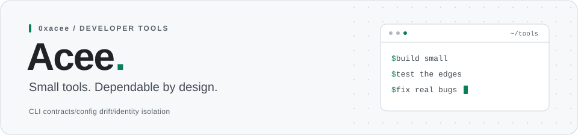

<picture>
  <source media="(prefers-color-scheme: dark)" srcset="./assets/header-dark.svg">
  <source media="(prefers-color-scheme: light)" srcset="./assets/header-light.svg">
  
</picture>

I build small, dependable developer tools and fix real bugs in the projects I use.

### Tools I maintain

| Project | What it does |
| :--- | :--- |
| [**gitcage**](https://github.com/0xacee/gitcage) | Isolated GitHub identity workspaces for Windows. PowerShell &middot; WSL2 |
| [**cliwitness**](https://github.com/0xacee/cliwitness) | Executable contracts for command-line interfaces. Python &middot; zero dependencies |
| [**envatlas**](https://github.com/0xacee/envatlas) | Maps environment-variable contracts across code, containers, and CI without exposing values. Node.js &middot; zero dependencies |
| [**identitylint**](https://github.com/0xacee/identitylint) | Policy-as-code guardrails for Git and GitHub account boundaries. JavaScript |
| [**fixtureguard**](https://github.com/0xacee/fixtureguard) | Catches host-specific paths and addresses in committed test fixtures. JavaScript |

### Open-source contributions

Currently contributing to [**Osmantic/ODS**](https://github.com/Osmantic/ODS),
with a focus on installer reliability, shell behavior, and dashboard API correctness.

---

> **Boring on purpose.** Contract tests, config drift, identity isolation &mdash; the stuff that breaks at 2 AM.
